<p align="center">
  
</p>

<h1 align="center">Coffee Delivery</h1>

<p align="center">
  E-commerce de uma cafeteria fictícia — projeto final da disciplina de <strong>Single Page Application</strong>.
</p>

<p align="center">
  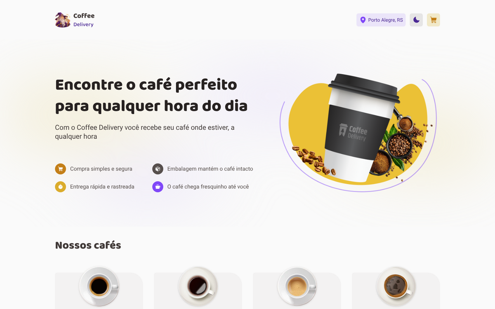
</p>

## Sobre

No Coffee Delivery o usuário navega por um catálogo de 14 cafés, adiciona itens ao carrinho, informa o endereço de entrega, escolhe a forma de pagamento e finaliza um pedido fictício. O layout segue o protótipo do Figma, com identidade visual própria (mascote criado com IA), Dark Mode e interface responsiva.

## Funcionalidades

- [x] Catálogo de cafés com tags, descrição e preço
- [x] Seleção de quantidade e adição ao carrinho, com contador no header
- [x] Carrinho persistido no LocalStorage (sobrevive ao recarregar a página)
- [x] Checkout com alteração de quantidade, remoção de itens e totais em tempo real
- [x] Formulário validado com React Hook Form + Zod
- [x] Autopreenchimento do endereço pelo CEP (API ViaCEP)
- [x] Escolha da forma de pagamento (crédito, débito ou dinheiro)
- [x] Página de pedido confirmado com endereço, previsão e pagamento
- [x] Troca da localização pelo header, com busca por CEP em um mini modal
- [x] Aviso animado ao adicionar um café à sacola, com atalho "Ver sacola"
- [x] Dark Mode / Light Mode com preferência salva
- [x] Layout responsivo (mobile, tablet e desktop)
- [x] Logo original criada com Inteligência Artificial

## Tecnologias

React 19 · Vite · TypeScript · Tailwind CSS 4 · React Router (com lazy loading) · Context API + useReducer · React Hook Form · Zod · Phosphor Icons · Vitest · Testing Library · ESLint

## Como executar

Pré-requisitos: **Node.js 20+** e **npm**.

```bash
git clone <url-do-repositorio>
cd coffee-delivery
npm install
npm run dev
```

Acesse `http://localhost:5173`.

| Script | Descrição |
|---|---|
| `npm run dev` | Servidor de desenvolvimento |
| `npm run build` | Checagem de tipos + build de produção |
| `npm run preview` | Servir o build localmente |
| `npm run lint` | ESLint |
| `npm test` | 39 testes com Vitest + Testing Library |

## Estrutura

```
src/
├── assets/        imagens extraídas do Figma e logo
├── components/    Header, Logo, LocationPicker, AddedToCartToast, ThemeToggle, Input…
├── contexts/      Cart, Theme, Location e CartFeedback
├── data/          catálogo de cafés
├── hooks/         useCart, useTheme, useDeliveryLocation, useCartFeedback, useCepLookup
├── layouts/       DefaultLayout
├── pages/         Home, Checkout, Success
├── reducers/cart/ actions, reducer, tipos, persistência e testes
├── routes/        React Router
├── schemas/       validação do checkout (Zod)
├── services/      ViaCEP
└── styles/        Tailwind + tokens de tema
```

Detalhes em [TECH_SPEC.md](TECH_SPEC.md).

## Documentação

| Documento | Conteúdo |
|---|---|
| [PRD_SPEC.md](PRD_SPEC.md) | Produto, requisitos, regras de negócio e critérios de aceite |
| [TECH_SPEC.md](TECH_SPEC.md) | Arquitetura, componentes, estado e testes |
| [TASKS_SPEC.md](TASKS_SPEC.md) | Planejamento e acompanhamento das etapas |
| [AGENTS.md](AGENTS.md) | Diretrizes e registro de uso do assistente de IA |

## Evidências do desenvolvimento

### Protótipo do Figma
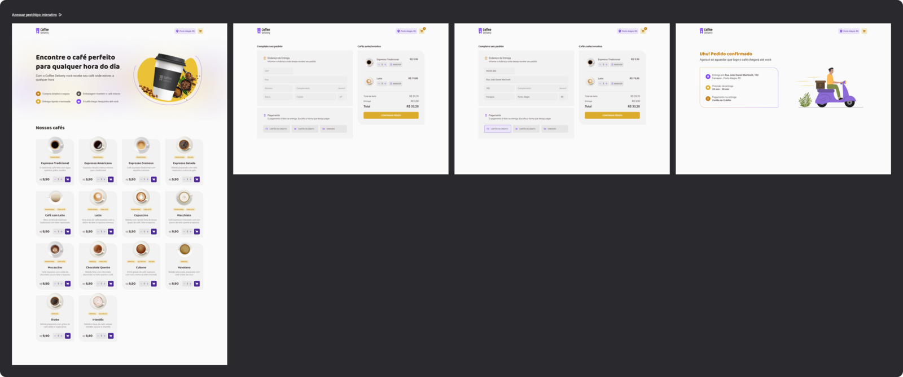

### Light Mode e Dark Mode
| Light | Dark |
|---|---|
|  | 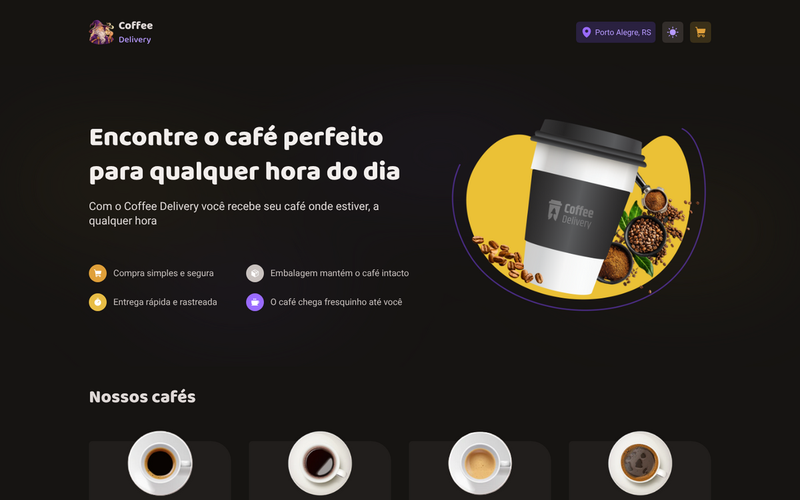 |

### Checkout
| Validação (React Hook Form + Zod) | Formulário preenchido |
|---|---|
| 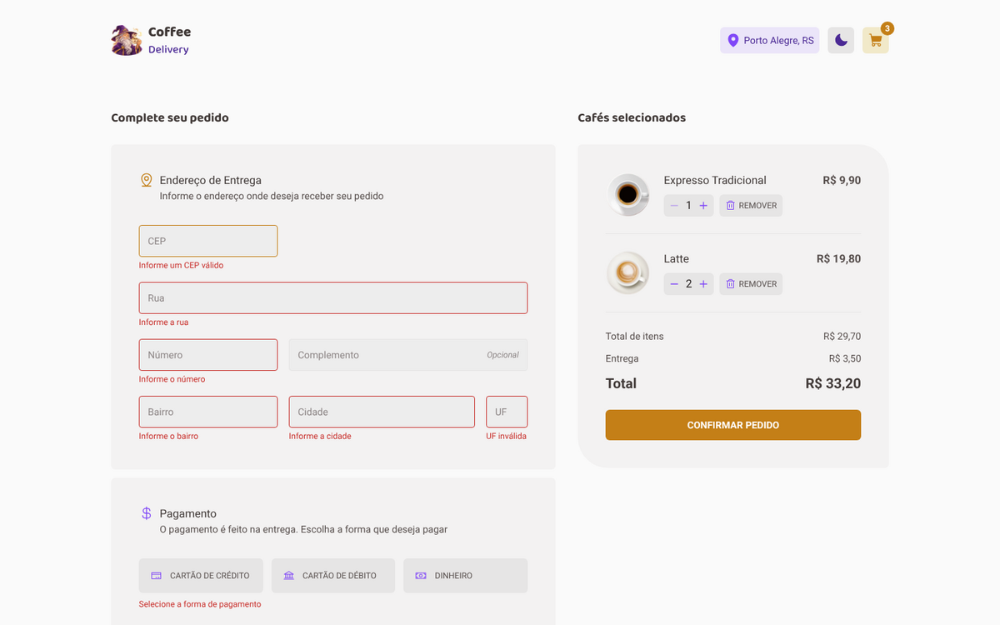 | 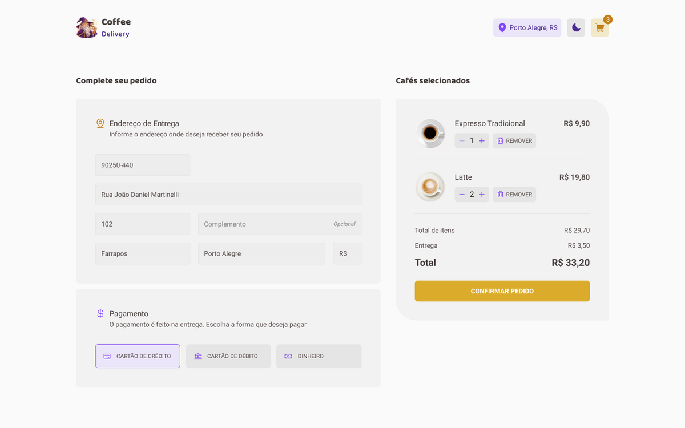 |

### Localização por CEP e feedback de sacola
| Mini modal de localização | Aviso "Adicionado à sacola" |
|---|---|
| 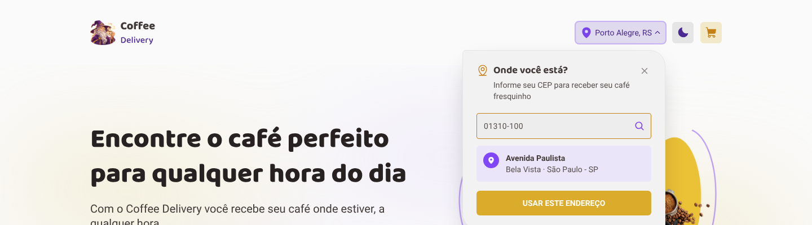 | 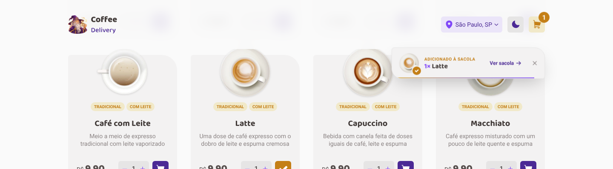 |
| 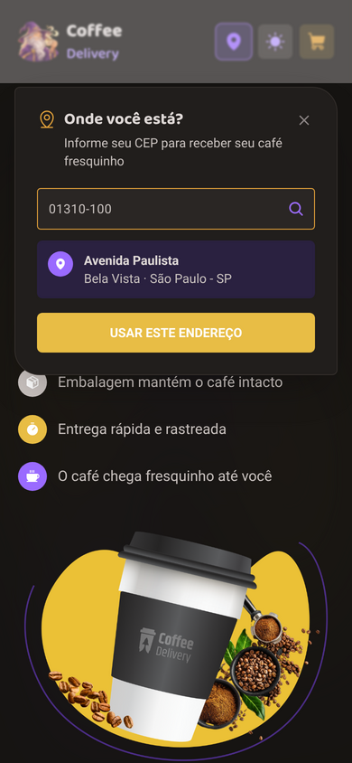 | 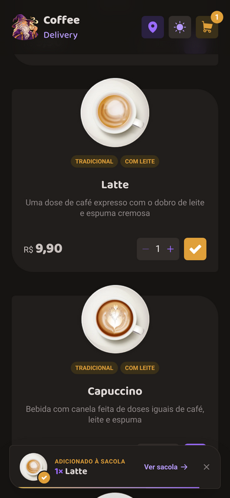 |

### Pedido confirmado
| Light | Dark |
|---|---|
| 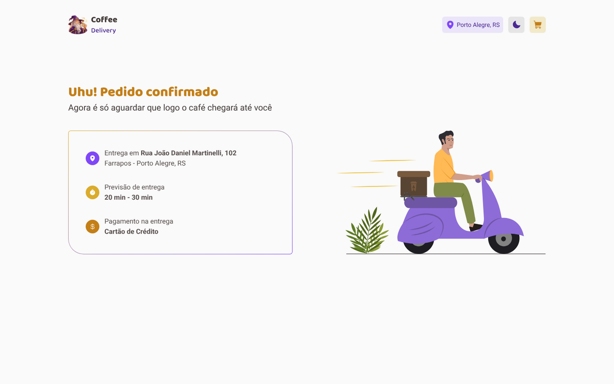 | 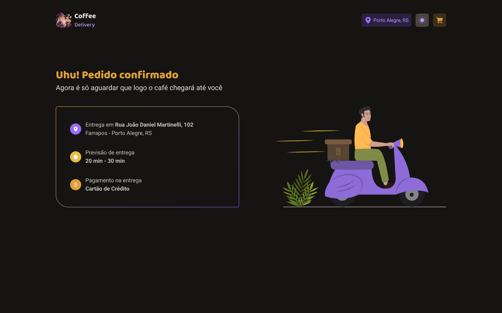 |

### Responsividade
| Mobile | Mobile (dark) | Checkout mobile | Tablet |
|---|---|---|---|
| 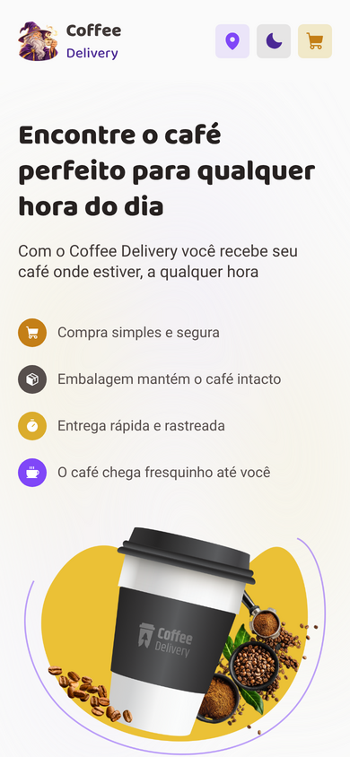 | 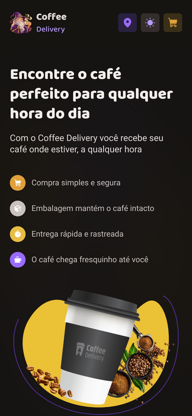 | 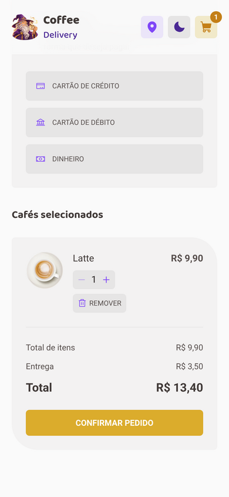 | 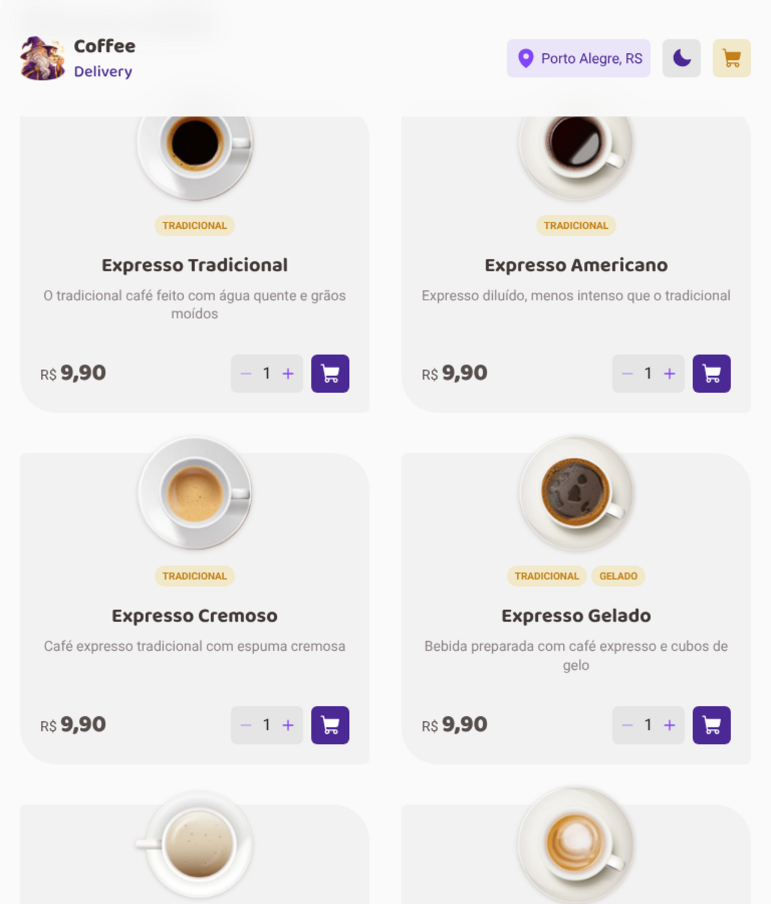 |

## Identidade visual

A logo é um mascote original — um mago com chapéu roxo segurando uma xícara de café — gerado com Inteligência Artificial. As cores roxo e dourado conversam com a paleta do Figma. O arquivo original está em [`docs/identidade/logo-original.png`](docs/identidade/logo-original.png).

## Uso de Inteligência Artificial

Um assistente de IA (Claude) foi usado no planejamento, na extração dos assets do Figma, no desenvolvimento, nos testes e na revisão. O projeto foi construído em etapas e cada etapa foi revisada e versionada pelo aluno. O registro completo está no [AGENTS.md](AGENTS.md).

## Autor

Kaua — projeto acadêmico.
